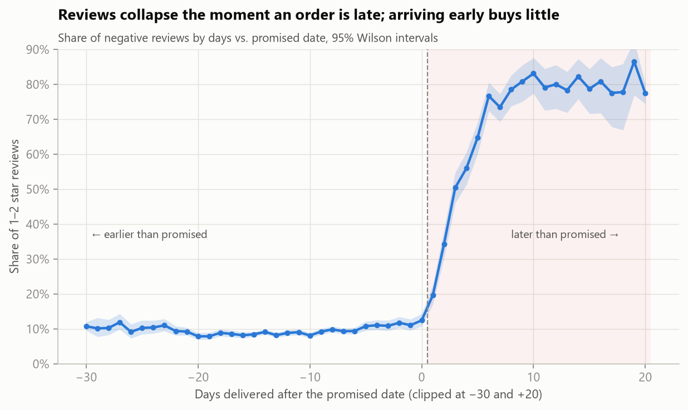
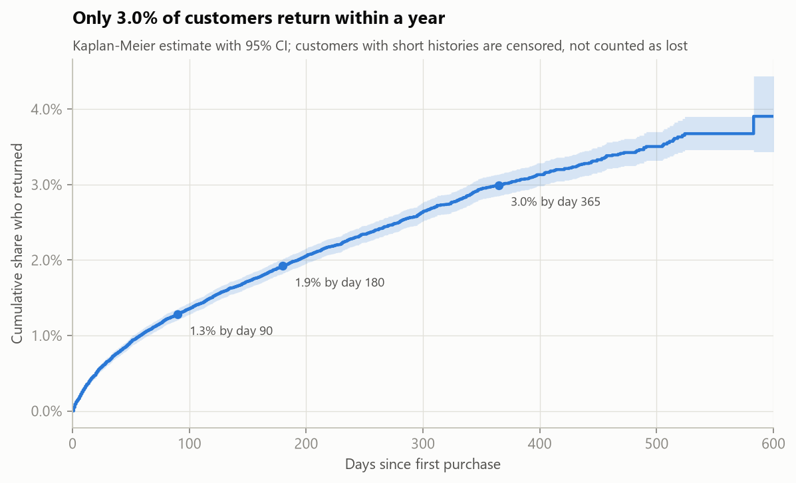
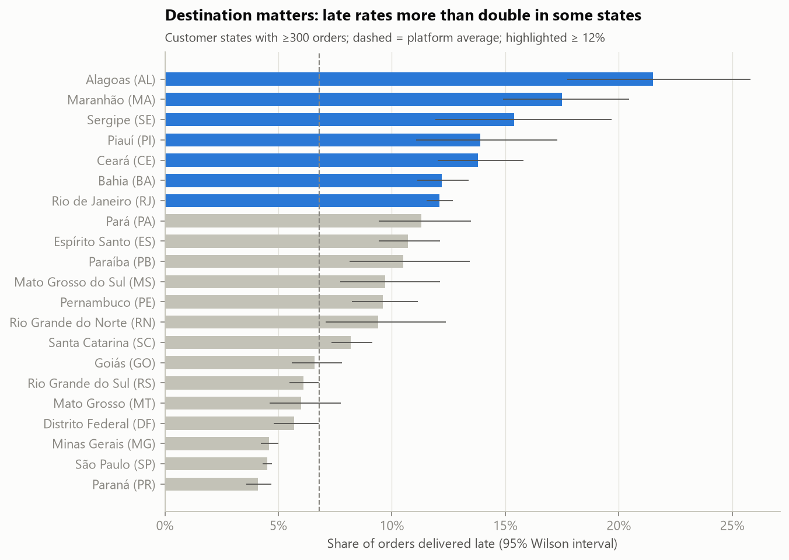

# Why don't Olist customers come back, and what should Olist fix first?

**Retention, delivery experience and reviews in 96k Brazilian e-commerce orders. SQL (DuckDB) + Python.**

> **Answer:** retention is low for structural reasons, and delivery experience barely moves it. Lateness, however,
> is the main driver of negative reviews. Olist should treat on-time delivery as **review protection**, starting with
> the **Rio de Janeiro** route, which alone produces 42 % of excess late orders.

| Finding | Evidence |
|---|---|
| **True retention is ~2 %, not 3 %** | 30 % of "repeat" orders are split baskets placed the same day. Only **1.9 %** of customers return within 180 days, and **3.0 %** within a year (Kaplan-Meier). |
| **Experience moves retention only at the margin** | A 1–2 star first order lowers the return rate by **0.4 points**. A model using every first-order signal reaches only **AUC 0.55**. |
| **Lateness drives bad reviews** | Negative reviews go from **~10 %** on time to **~80 %** at 8+ days late. A 1–3 day delay multiplies the odds of a 1–2 star review by **3.7**, and the effect holds *within the same seller*. |
| **It's a carrier problem, concentrated by route** | Late orders spend **26 days with the carrier vs 7**. Rio de Janeiro has a 12 % late rate on 12k orders vs 4.5 % for São Paulo. |
| **Fixing it pays off in reviews, not retention** | Halving late deliveries avoids **~167 negative reviews per 10k orders** (13 % of all negative reviews), but adds only about **1 returning customer per 10k** (not significant). |



## What's in the analysis

| § | Question | Technique |
|---|---|---|
| 1 | Can the data be trusted? | SQL integrity checks; identity resolution (`customer_id` vs `customer_unique_id`); split-basket detection |
| 2 | How low is retention, really? | Cohort retention with window functions; **Kaplan-Meier** survival with censoring |
| 3 | Does late delivery hurt reviews? | Logistic regression with controls and seller-clustered errors; **within-seller fixed effects** |
| 4 | Do bad experiences reduce repurchase? | Logistic regression, average marginal effects, **direct vs total effect** of lateness; survival curves with log-rank test |
| 5 | Can we segment one-time buyers? | Shows why **RFM silently fails** (`NTILE` splits identical customers); first-order segments with Wilson intervals |
| 6 | Can we predict who returns? | **Time-based split**, leak-free target encoding, logistic vs gradient boosting, lift and permutation importance |
| 7 | Sellers or routes? | Delay decomposition (seller vs carrier), **empirical-Bayes shrinkage** of seller late rates, excess late orders by state |
| 8 | What is fixing it worth? | Counterfactual simulation with 2,000 coefficient draws |

<table><tr>
<td></td>
<td></td>
</tr></table>

## Recommendation

1. **Fix the Rio de Janeiro route** (carrier review, alternative-carrier pilot). Matching São Paulo's late rate removes about 940 late orders, 14 % of the platform total.
2. **Extend to Bahia, then Ceará and Maranhão.** RJ and Bahia together cover 54 % of excess late orders.
3. **Enforce seller handover deadlines** for the 142 sellers who handle 10 % of volume but cause 23 % of late orders.
4. **A/B test tighter delivery promises.** Promises average 24 days against a median actual of 10.
5. **Don't fund targeted retention.** Retention is structural, and first-order data can't identify returners.

**Success metric:** late-delivery rate by destination state, with the share of 1–2 star reviews as the outcome.

## Honest limitations

- Observational data. The controls and within-seller comparisons strengthen the causal reading but do not prove it.
- One marketplace integrator in Brazil, 2017–2018.
- No marketing or listing-conversion data, so the link from reviews to sales is argued, not measured.
- 180-day return window; long-cycle categories are partly covered by the survival analysis.

## Repository layout

```
├── notebooks/olist_retention_and_delivery.ipynb   # full analysis, executed (SQL + Python)
├── sql/01_staging.sql                             # data model: staging, order fact table, customer table
├── src/build_db.py                                # builds data/olist.duckdb from the raw CSVs
├── src/viz.py                                     # shared chart style
└── reports/figures/                               # all charts
```

## Reproduce

1. Download the [Olist dataset from Kaggle](https://www.kaggle.com/datasets/olistbr/brazilian-ecommerce) and unzip the 9 CSVs into `data/raw/`.
   The data is licensed CC BY-NC-SA 4.0 and is not redistributed here.
2. Run:

```bash
python -m venv .venv && .venv/Scripts/activate      # macOS/Linux: source .venv/bin/activate
pip install -r requirements.txt
python src/build_db.py                              # ~5 seconds
jupyter nbconvert --to notebook --execute --inplace notebooks/olist_retention_and_delivery.ipynb
```
